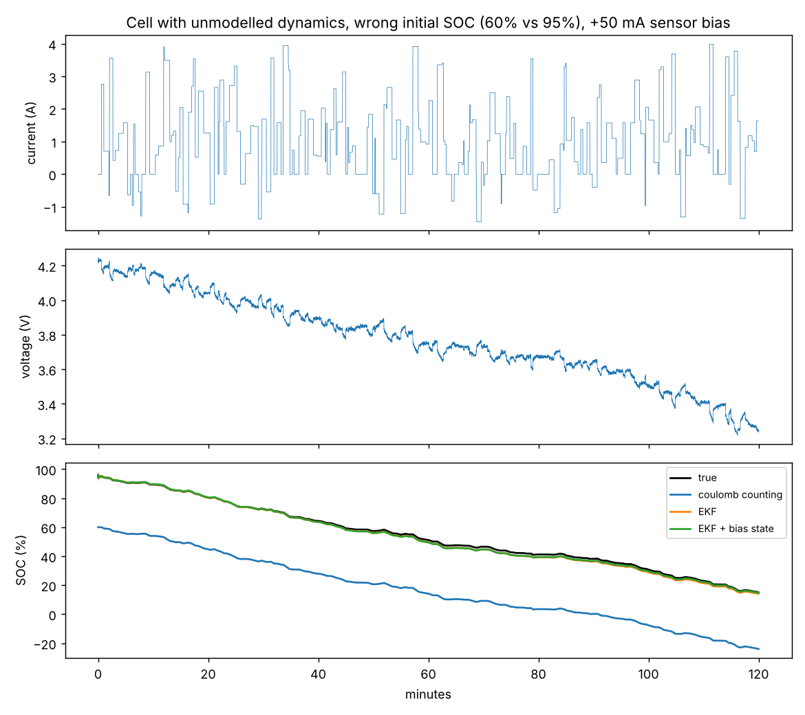

# Battery State-of-Charge Estimation with an Extended Kalman Filter

How full is a battery? You cannot measure state of charge (SOC) directly — only current and voltage. This project builds
a first-order **Thevenin equivalent-circuit model**, identifies its parameters from a pulse test, and compares
**coulomb counting** with an **extended Kalman filter (EKF)** (Plett 2004) and an EKF that also estimates current-sensor bias,
on a "real" cell that has physics the filter does not model.

## Contents
| File | What it does |
|---|---|
| `src/batt/model.py` | OCV(SOC) curve (Plett's combined model), 1-RC cell plus optional slow 2nd RC branch and OCV-table error; drive-cycle and HPPC pulse generators |
| `src/batt/identify.py` | Nonlinear least-squares fit of R0, R1, τ from a pulse test, with standard errors |
| `src/batt/estimators.py` | Coulomb counting; EKF on [SOC, v_RC]; EKF on [SOC, v_RC, current bias] |
| `scripts/run_experiments.py` | Identification accuracy + 10 SOC scenarios × 10 drive cycles |

## Results

**Parameter identification** (HPPC pulses at 50% SOC, 2 mV / 5 mA noise, 20 repetitions): R0 within **0.14%**, R1 within
0.02%, time constant 25.2 ± 1.1 s (true 25 s); fit RMSE 2.0 mV, equal to the noise level.

**SOC estimation** — 2-hour drive cycles (95% → 15% SOC), 5 mV voltage noise, 20 mA current noise; RMSE in SOC
percentage points, mean of 10 cycles. The "real" cell adds a 400 s RC branch and a 10 mV OCV-table error that the filter does not know about.

| Scenario (real cell) | Coulomb counting | EKF | EKF + bias state |
|---|---|---|---|
| Initial SOC known, unbiased sensor | **0.01** | 0.60 | 1.06 |
| Initial SOC guessed as 60% (true 95%) | 35.0 | **0.60** | 1.06 |
| +50 mA current-sensor bias | 2.31 (4.0 at end) | 1.22 | **1.06** |
| Wrong initial SOC **and** +50 mA bias | 37.0 | 1.22 | **1.06** |
| Capacity overestimated by 10% | 4.23 | 0.99 | **0.93** |

- Coulomb counting is perfect only when the start is known and the sensor is perfect; any offset accumulates forever.
- The EKF uses the voltage to correct itself: from a 35-point initial error it converges within minutes.
- With unmodelled dynamics the EKF's own uncertainty is **over-confident**: the true SOC lies inside its ±2σ band only
  2–16% of the time (100% for a model-matched cell with known capacity and an unbiased sensor), so the filter's covariance should not be trusted without retuning.



Full tables (including the model-matched cell): [`results/summary.md`](results/summary.md)

## Run
```bash
pip install -r requirements.txt
python -m unittest discover -s tests -v
python scripts/run_experiments.py      # ~20 s
```
